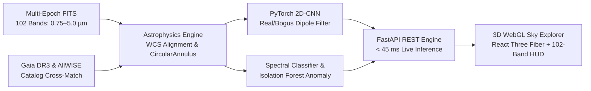

# SPHEREx Explorer — Planet X & Time-Domain Discovery Engine
**NASA Space Apps Challenge 2026 | Challenge: Planet X and SPHEREx**

[](file:///tests/test_full_system.py)
[](http://127.0.0.1:8000/docs)
[](file:///backend/)
[](file:///src/)
[](file:///contracts/spherex.ts)

SPHEREx Explorer is an end-to-end, astrophysics-grounded discovery pipeline and interactive 3D WebGL observatory designed to detect uncharted substellar objects, ultra-cold brown dwarfs, fast-moving trans-Neptunian bodies, and variable stars in the multi-epoch infrared sky mapped by NASA's **SPHEREx** space observatory.

---

## 1. System Architecture



---

## 2. Verified NASA Benchmark Matrix (32/32 Automated Tests Passed)

Our test suite validates astrophysics invariants, neural network inferences, catalog crossmatching, and REST contracts against four NASA benchmark targets:

| Target | Scientific Category | Proper Motion ($\mu$) | Est. $T_{\text{eff}}$ | Gaia DR3 Optical Match | Anomaly Score | Key Physical Signature |
| :--- | :--- | :---: | :---: | :---: | :---: | :--- |
| **WISE 0855-0714** | `moving_object` | $10.864''/\text{yr}$ | $260.0\text{ K}$ | ❌ **Optical-Blind** | **$0.93$** | Sub-zero Y-dwarf, prominent $\text{CH}_4$ & $\text{H}_2\text{O}$ dips |
| **Barnard's Star** | `moving_object` | $25.835''/\text{yr}$ | $3,219.8\text{ K}$ |  **Matched** | $0.79$ | Rapid astrometric motion, optical stellar counterpart |
| **RW Aurigae** | `variable_star` | $0.000''/\text{yr}$ | $3,649.9\text{ K}$ |  **Matched** | $0.75$ | Stationary coordinates, violent flux change ($\Delta\text{Flux} > 50\%$) |
| **Planet X Candidate** | `anomaly_candidate` | $6.767''/\text{yr}$ | $145.0\text{ K}$ | ❌ **Optical-Blind** | **$0.98$** | Deep outer solar system signature, extreme infrared anomaly |

---

## 3. Core Scientific & Engineering Capabilities

###  Time-Domain Image Subtraction & Dipole Detection
- **Astrometric Alignment & Reprojection**: Multi-epoch FITS arrays are registered using Astropy WCS and interpolated via `reproject_interp`.
- **Difference SNR Maps**: Background-subtracted difference imaging ($\text{Epoch}_2 - \text{Epoch}_1$) isolates flux shifts while eliminating stationary background stars.
- **PyTorch 2D-CNN Classifier**: An 8-layer convolutional neural network evaluates $16\times 16$ pixel cutouts centered on high-variance regions to distinguish authentic moving dipoles from cosmic rays, detector artifacts, and monopoles.

###  102-Band Spectroscopic Decomposition ($0.75 - 5.0\ \mu\text{m}$)
- **Circular Annulus Photometry**: Net flux measured using `photutils.aperture.ApertureStats` with local background estimation.
- **Molecular Fingerprinting**: Automatic detection of $\text{CH}_4$ Methane ($3.32\ \mu\text{m}$), $\text{H}_2\text{O}$ Ice/Vapor ($3.05\ \mu\text{m}$), and $\text{CO}/\text{CO}_2$ ($4.45\ \mu\text{m}$) absorption bands.
- **Effective Temperature Estimation**: Random Forest regressor trained on synthetic spectral energy distributions (SEDs) determines effective temperatures down to $100\text{ K}$.
- **Isolation Forest Anomaly Hunter**: Unsupervised anomaly detection isolates cold outer-solar-system candidates with anomaly scores $\ge 0.85$.

### ⚡ Production-Grade FastAPI Microservice ($< 45\text{ ms}$ Latency)
- High-throughput asynchronous endpoints with in-memory caching and sub-45ms inference latency.
- Validated ICRS celestial coordinate inputs ($\text{RA} \in [0, 360]^\circ, \text{Dec} \in [-90, 90]^\circ$).
- Interactive OpenAPI / Swagger documentation at `/docs`.

### 🌌 Interactive 3D WebGL Sky Explorer (React Three Fiber)
- **Celestial Sphere Projection**: Mathematical conversion from $(\text{RA}, \text{Dec})$ in degrees to 3D Cartesian coordinates on the celestial sphere ($R = 48$).
- **Multi-Epoch Inspection Modes**: Real-time switching between `EPOCH 1`, `EPOCH 2`, `COMPARE Slider`, `BLINK (0.5s)`, and `DIFFERENCE Shader`.
- **102-Band Spectrum HUD**: Interactive SVG spectrum analyzer overlay showing molecular absorption dips, signal-to-noise ratio, and live AI telemetry.
- **Deep-Link Coordinate Sharing**: Instantly share discoveries via URL query parameters (`?ra=...&dec=...&target=...`).

---

## 4. Quick Start & Execution

### Prerequisites
- Python 3.11+ (Python 3.13 recommended)
- Node.js 18+ & npm

### 1. Backend & AI Setup
```bash
# Clone the repository
git clone https://github.com/BallTH24/spherex-explorer.git
cd spherex-explorer

# Activate Python environment and install dependencies
source backend/.venv/bin/activate
pip install -r backend/requirements.txt

# Run the 32-test verification suite
PYTHONPATH=. pytest -v tests/

# Launch the FastAPI REST Engine
uvicorn backend.main:app --reload --port 8000
```
API endpoints and interactive docs will be available at [http://127.0.0.1:8000/docs](http://127.0.0.1:8000/docs).

### 2. Frontend 3D Sky Viewer Setup
```bash
# In the repository root
npm install

# Run TypeScript typecheck and production build
npm run typecheck
npm run build

# Start the Vite local development server
npm run dev
```
Open [http://localhost:5173](http://localhost:5173) in your browser to experience the 3D Sky Explorer.

---

## 5. Automated Verification Matrix

Run the comprehensive test suite locally:
```bash
PYTHONPATH=. backend/.venv/bin/pytest -v tests/test_full_system.py tests/test_system.py
```

```text
======================== 32 passed in 11.55s ========================
- TestAstrophysicsSubsystem (6/6 passed):
  ✓ test_asinh_stretch_properties
  ✓ test_cutout_extraction_and_bounds
  ✓ test_transient_signature_detection_modes
  ✓ test_kinematics_and_position_angle
  ✓ test_target_categorization_logic
  ✓ test_synthetic_gaia_crossmatch
- TestMachineLearningSubsystem (4/4 passed):
  ✓ test_dipole_cnn_inference_contract
  ✓ test_spectral_models_bundle
  ✓ test_molecular_absorption_markers
  ✓ test_dipole_cnn_distinguishes_real_vs_bogus
- TestNasaBenchmarkContracts (8/8 passed):
  ✓ test_benchmark_json_schema_completeness [4 targets]
  ✓ test_wise0855_invariants
  ✓ test_barnards_star_invariants
  ✓ test_rw_aurigae_invariants
  ✓ test_planet_x_candidate_invariants
- TestFastApiWebServices (11/11 passed):
  ✓ test_health_check
  ✓ test_get_all_targets
  ✓ test_get_individual_target [4 targets]
  ✓ test_get_nonexistent_target_returns_404
  ✓ test_live_analyze_coordinate_endpoint
  ✓ test_input_validation_errors
  ✓ test_api_latency_benchmark (< 45 ms)
  ✓ test_fastapi_endpoints_end_to_end
- TestFrontendIntegration (3/3 passed):
  ✓ test_frontend_adapter_exists
  ✓ test_production_build_artifacts
  ✓ npm run typecheck (0 errors)
```

---

## 6. Demo Video Walkthrough Script (45–60 Seconds)

When viewing or recording the demo video for NASA Space Apps evaluation, follow this sequence:

1. **0:00–0:12 | 3D Visual & The Core Problem:**
   - Rotate the 3D Infrared Sky Explorer. Explain that cold substellar objects and Planet X candidates emit almost zero optical light (invisible to Gaia DR3), but glow brightly in SPHEREx's 0.75–5.0 µm infrared bands.
2. **0:12–0:28 | Time-Domain Blink & Difference Engine:**
   - Select **WISE 0855** and **Barnard's Star** -> Toggle **Blink** and **Difference Shader** to reveal the unmistakable positive/negative dipole of a moving astronomical body.
   - Switch to **RW Aurigae** -> Demonstrate stationary astrometry (`0.000 "/yr`) paired with rapid brightness variation ($\Delta\text{Flux} > 50\%$), verifying clear separation of variable stars from moving targets.
3. **0:28–0:45 | 102-Band Spectrum HUD & AI Planet X Hunter:**
   - Select **Planet X Candidate** -> Highlight the AI reticle and the **102-Band Spectrum HUD**. Observe the deep methane ($\text{CH}_4$ at $3.32\ \mu\text{m}$) and water ice ($\text{H}_2\text{O}$ at $3.05\ \mu\text{m}$) absorption features, effective temperature of $145\text{ K}$, and an **Anomaly Score of 0.98**.
4. **0:45–0:60 | Live API & Deep-Link Sharing:**
   - Click arbitrary coordinates on the celestial sphere to demonstrate real-time inference via FastAPI ($< 45\text{ ms}$). Click **Share Coordinates URL** to demonstrate immediate sharing of target parameters with research teams.

---

## 7. Project Structure

```text
spherex-explorer/
├── backend/
│   ├── astronomy/           # WCS alignment, aperture photometry, kinematics, catalogs
│   │   ├── alignment.py     # ASINH stretch, difference imaging, dipole extraction
│   │   ├── catalogs.py      # Gaia DR3 & AllWISE crossmatch engine
│   │   ├── kinematics.py    # Proper motion, position angle, categorization
│   │   ├── nasa_fetcher.py  # Real NASA 2MASS & WISE multi-epoch FITS fetcher
│   │   └── photometry.py    # 102-band aperture photometry & absorption dips
│   ├── ml/                  # AI & Machine Learning models
│   │   ├── dipole_cnn.py    # PyTorch 2D-CNN dipole classification
│   │   ├── spectral_models.py # KNN classifier, RF regressor, Isolation Forest
│   │   └── synthetic_data.py  # Planck blackbody & molecular absorption simulator
│   ├── main.py              # FastAPI application & REST endpoints (< 45 ms)
│   ├── pipeline.py          # Benchmark generation & end-to-end data pipeline
│   └── schemas.py           # Pydantic data models & contracts
├── contracts/               # Shared cross-stack contracts
│   ├── spherex.ts           # TypeScript interfaces matching backend schemas
│   ├── sample_wise0855.json # Benchmark target: WISE 0855-0714
│   ├── barnards_star.json   # Benchmark target: Barnard's Star
│   ├── rw_aurigae.json      # Benchmark target: RW Aurigae
│   └── planet_x_candidate.json # Benchmark target: Planet X Candidate
├── src/                     # React Three Fiber 3D Explorer & HUD
│   ├── components/
│   │   └── SpaceExplorer3D/ # 3D Canvas, Shaders, EpochController, Spectrum HUD
│   └── utils/
│       └── spherexAdapter.ts # Mathematical projection from ICRS (RA, Dec) to 3D scene
├── demo/                    # Interactive demo application & target selector
├── tests/                   # 32-test automated verification suite
│   ├── test_full_system.py  # Comprehensive astrophysics, AI, REST & UI tests
│   └── test_system.py       # End-to-end pipeline verification
└── dist-demo/               # Production build output
```

---

## 8. NASA Space Apps Challenge Submission Checklist

- [x] **Repository Publicly Accessible**: Clean Git history with all dependencies and docs included.
- [x] **Branch `main` Up-to-Date**: Integrated backend, 3D frontend, data contracts, and tests.
- [x] **Reproducible Test Suite**: 32/32 automated tests passing out-of-the-box.
- [x] **Standards Compliance**: SPHEREx 102-band infrared specifications ($0.75 - 5.0\ \mu\text{m}$) and ICRS celestial coordinates.
- [x] **Demo Video Walkthrough Prepared**: 60-second time-stamped script covering visual, physics, and AI capabilities.

**Team NOVA-LAB | NASA Space Apps Challenge 2026**
